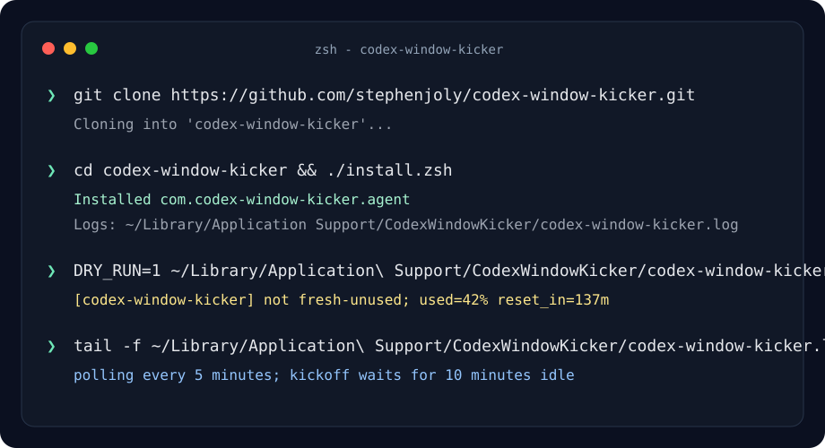

# Codex Window Kicker

Start a fresh Codex usage window automatically after it resets.

Also supports Claude Code, with its own background job and independent controls.

Codex Window Kicker runs quietly in the background on macOS. Every 5 minutes it asks CodexBar for your Codex usage status. If the 5-hour window is freshly reset, still unused, and remains unused for 10 minutes, it sends one tiny `pong` prompt to start the new window.



## Why

If your Codex limit resets while you are away, the next usage window may not start until you send your next prompt. This utility starts that window shortly after reset so the next reset is already counting down when you return.

## Requirements

- macOS
- [Codex CLI](https://github.com/openai/codex)
- [CodexBar CLI](https://github.com/steipete/CodexBar) — reports Codex usage status
- [jq](https://jqlang.github.io/jq/) — command-line JSON processor

All three can be installed with [Homebrew](https://brew.sh). The installer will offer to install any missing dependencies automatically.

For Claude, install Claude Code instead of Codex CLI and sign in with your Claude subscription (`claude auth login`). CodexBar and jq are still required.

## Claude background kickoff

```sh
./install.zsh claude
```

This enables a separate `com.claude-window-kicker.agent` LaunchAgent. Every five minutes it checks Claude usage through CodexBar's automatic source. Once the five-hour reset has passed and the window stays idle for ten minutes, it sends one tiny `Reply exactly: pong` prompt using Haiku. If you already started a new window, it skips the prompt—even if usage rounds to 0%.

The kickoff uses your subscription login, with API-key and third-party billing environment overrides removed. It disables tools, MCP servers, session persistence, and user customizations using the installed Claude CLI's [isolation options](https://code.claude.com/docs/en/cli-reference). It skips unavailable/invalid usage data and exhausted weekly limits, suppresses duplicate successful kickoffs, and waits at least fifteen minutes between failed attempts. It does not bypass subscription limits. The Mac must be awake and your user session logged in; it checks again after sleep.

Claude files live in `~/Library/Application Support/ClaudeWindowKicker/`. Manage the job independently:

```sh
CONTROL="$HOME/Library/Application Support/ClaudeWindowKicker/claude-window-kicker-control.zsh"
"$CONTROL" status
"$CONTROL" off
"$CONTROL" on

tail -f "$HOME/Library/Application Support/ClaudeWindowKicker/claude-window-kicker.log"
DRY_RUN=1 "$HOME/Library/Application Support/ClaudeWindowKicker/claude-window-kicker.zsh"
```

Dry-run uses the normal waiting/eligibility checks but never sends a prompt or marks a kickoff successful. If logs report unavailable usage, check `codexbar usage --provider claude --source auto` and your Claude login. OAuth-only CodexBar checks can fail with expired credentials even when the automatic CLI fallback works.

Remove only the Claude LaunchAgent (keep logs/state):

```sh
./uninstall.zsh claude
```

Running install or uninstall without a provider still targets Codex. Installing Claude leaves the Codex job and state in place.

## Install

For an always-on Linux server, see [server setup and rollback](server/README.md). The server uses systemd timers and existing provider logins in the Paseo container. Keep a single scheduler per account: verify the server first, then turn off the Mac jobs.

```sh
git clone https://github.com/stephenjoly/codex-window-kicker.git
cd codex-window-kicker
./install.zsh
```

The installer copies the runtime script to:

```text
~/Library/Application Support/CodexWindowKicker/
```

It installs this LaunchAgent:

```text
~/Library/LaunchAgents/com.codex-window-kicker.agent.plist
```

The runtime copy intentionally lives outside `Documents`, because macOS privacy controls can prevent launchd from executing scripts directly from `Documents`.

The installer captures your current shell `PATH` into the LaunchAgent so that `codex`, `codexbar`, and `jq` are found at runtime. If you install new dependencies after setup, re-run `./install.zsh`.

## Kickoff Prompt

The automatic kickoff uses a minimal Codex command:

```sh
codex exec \
  --skip-git-repo-check \
  --ephemeral \
  --ignore-user-config \
  --ignore-rules \
  --sandbox read-only \
  --disable plugins \
  --disable apps \
  --disable browser_use \
  --disable browser_use_external \
  --disable computer_use \
  --disable image_generation \
  --disable multi_agent \
  --disable shell_tool \
  --disable unified_exec \
  -m gpt-5.4-mini \
  -c 'model_reasoning_effort="low"' \
  "Reply exactly: pong"
```

## Check Status

```sh
"$HOME/Library/Application Support/CodexWindowKicker/codex-window-kicker-control.zsh" status
tail -f "$HOME/Library/Application Support/CodexWindowKicker/codex-window-kicker.log"
```

## Enable or Disable

Keep the installation and its state, but stop or resume automatic kickoff prompts:

```sh
CONTROL="$HOME/Library/Application Support/CodexWindowKicker/codex-window-kicker-control.zsh"

"$CONTROL" off    # stop the LaunchAgent
"$CONTROL" on     # load and start it again
"$CONTROL" status # check whether it is enabled
```

Run `./install.zsh` once after updating to install the control command.

## Dry Run

Run the script without spending the kickoff prompt:

```sh
DRY_RUN=1 "$HOME/Library/Application Support/CodexWindowKicker/codex-window-kicker.zsh"
```

## Uninstall

```sh
./uninstall.zsh
```

To also remove logs and state:

```sh
rm -rf "$HOME/Library/Application Support/CodexWindowKicker"
```
